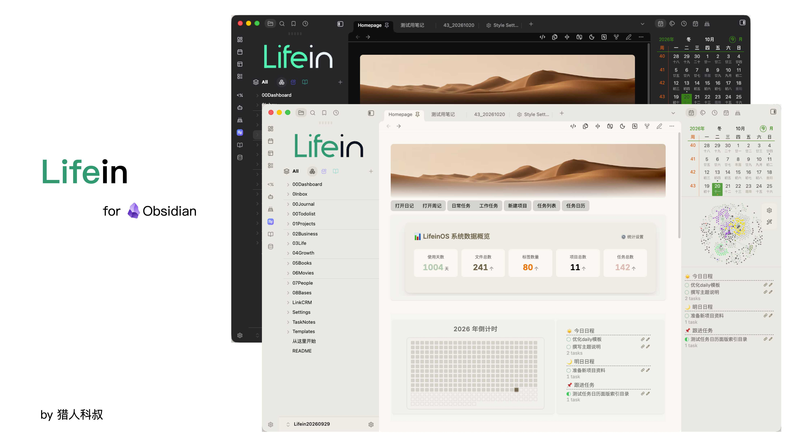
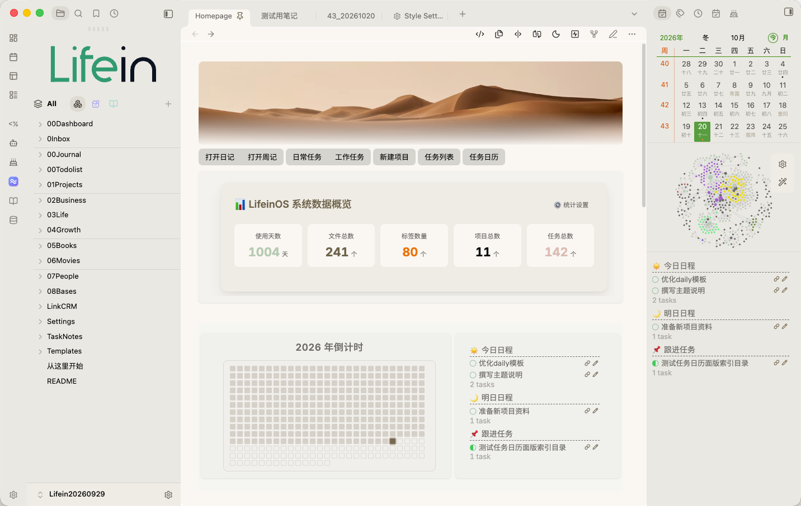
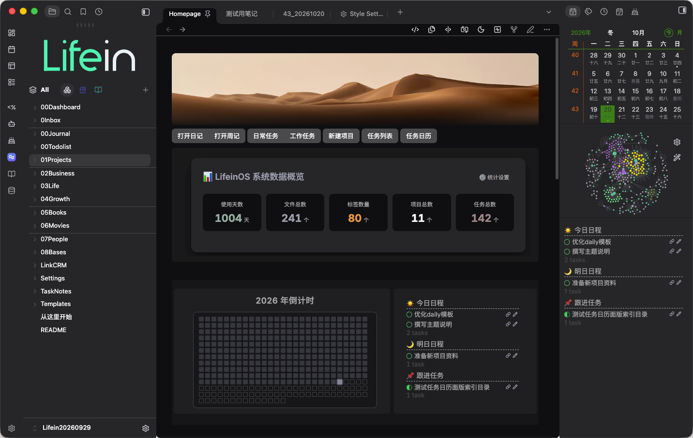
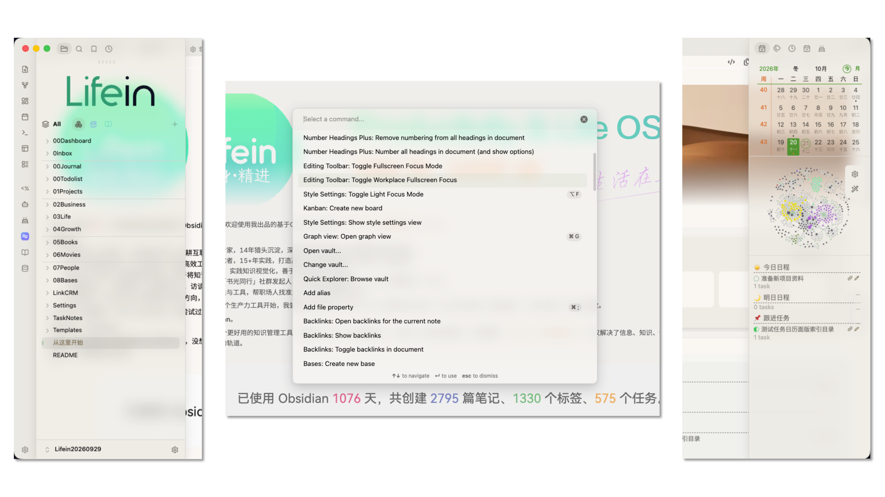

# Lifein — Make Obsidian Look the Way You Like

[English](./README.md) | [中文](./README_ZH.md)

> Lifein isn't just a recolor theme — it's a fully tunable interface system. Colors, layout, sidebar, typography, the properties panel, and plugin appearance all live in a single settings panel. Go minimal when you want minimal; go textured when you want texture.
>
> Built on a Glassmorphism visual language and deeply integrated with Style Settings, Lifein is made for focused writing. Less is more: let the interface quietly step back behind your content, and let your notes take center stage.

---

## 1 ✨ Key Features

### 1.1 🪟 Unified Glassmorphism Visuals

Menus, the command palette, popovers, tooltips, and the Style Settings panel all share one consistent "frosted glass" treatment:
semi-transparent backgrounds + background blur + a subtle saturation boost + a 1px hairline border + rounded corners.
We use only a single layer of glass to avoid the cheap "window-in-window" feel; blur intensity and opacity can be fine-tuned via Style Settings.

### 1.2 🎛 Deeply Integrated Style Settings

The theme ships two major settings blocks and a dozen-plus groups — nearly every detail is adjustable — and the settings panel itself has been reworked (horizontal layout + Lucide icons + the theme's green buttons) to look as good as it works:

- **Colors & Theme**: theme palette, background glass density / blur / saturation, and more.
- **Layout & Navigation**: title & status bar, Banner, sidebar, sidebar on hover.
- **Editing & Typography**: text, inline elements (quote bar · tags · links), lists, tables.
- **Popovers & Interaction**: command palette, menus, page preview.
- **Core Views & Components**: properties panel, Bases.
- **Community Plugin Styles**: Dataview, Calendar, Dust Calendar, Tasks, Kanban, and more.

> Installing the community plugin **Style Settings** is recommended to unlock all adjustments; the theme works fine with its default look even without it.

### 1.3 🎨 Ten Color Schemes (One-Click Reskin)

A built-in "derivation engine" generates the entire interface — backgrounds, text, sidebar, color blocks, code highlighting, and semantic colors — from a single seed color plus a set of saturation ceilings. Switching a scheme = switching the seed hue; the whole theme recolors itself, with no need to hand-tune dozens of variables.

- **10 presets**: Follow Accent Color (= default behavior) / Plain White / Warm Sand / Forest / Teal / Indigo / Jade Black / Rose / Graphite / Pure Black AMOLED.
- **Independent light & dark**: light and dark schemes are chosen separately (the community-standard approach) — the same color reads very differently on light vs. dark backgrounds, so separating them lets you tune accurately; "Pure Black · AMOLED" drives the background to true black in dark mode, saving power with a purer look.
- **Accent color included**: aside from "Follow Accent Color", every other scheme takes over the global accent — buttons, links, and selection states all follow the scheme; if you've explicitly chosen a color under Settings → Appearance → Accent Color, that choice wins and the scheme steps aside.

### 1.4 🧘 Two Focus Modes (Independent)

- **Full Focus Mode**: triggered when you enable Obsidian's native "Focus Mode". Automatically hides the main tab bar / per-page title bar / status bar (revealed on hover), centers the editor (720px + top padding), and dims inactive panes to minimize distraction.
- **Light Focus Mode**: a standalone lightweight focus mode. Hides tabs / title bar / status bar / properties heading / title-bar buttons / scrollbar, **with smooth fade in/out transitions**, and can be bound to a hotkey for one-key toggle in Style Settings.

### 1.5 📱 Cupertino-style Floating Sidebar

A macOS-inspired semi-transparent floating sidebar with customizable background color and toggle, matching the theme's overall glass aesthetic.

### 1.6 🌗 Automatic Light/Dark Inversion

Full light / dark support. Dark mode is achieved by inverting a whole group of variables, so there's no need to maintain two separate color sets.

### 1.7 🧩 Community Plugin Support

Common community plugins are styled and tucked in neatly: Dataview, Calendar, Dust Calendar, Tasks, Kanban — works out of the box and stays unobtrusive.

### 1.8 🗂 Bases View Support

The Core Views & Components group includes dedicated styling for Obsidian Bases.

---

## 2 📸 Screenshots

---

## 3 📦 Installation

### 3.1 Option 1: Obsidian Community Theme 

1. Open Obsidian → Settings → Appearance.
2. Click "Manage" → find **Lifein** in the theme list → enable it.

### 3.2 Option 2: Manual Installation

1. Download `theme.css` from this repository.
2. In your vault, create the directory `.obsidian/themes/Lifein/`.
3. Place `theme.css` inside it (final path: `your-vault/.obsidian/themes/Lifein/theme.css`).
4. Restart Obsidian → Settings → Appearance → Theme → select **Lifein**.

### 3.3 Customization (Optional)

1. Install the **Style Settings** community plugin.
2. Go to Settings → Community Plugins → Style Settings (or the command palette "Style Settings") to see all of Lifein's adjustable options.

### 3.4 Reading the Source (Optional)

`theme.css` in this repository is intentionally minified — it ships as a single line of CSS (plus the verbatim Style Settings `@settings` blocks) to stay well under the theme size limit. **This costs you nothing in adjustability**: every option still lives in the Style Settings panel.

If you'd rather read the code, the fully commented original ships right next to it as **[`theme.source.css`](./theme.source.css)** — 16,000+ lines, with a section banner and an explanation above nearly every block. Install with `theme.css`; read and fork from `theme.source.css`.

---

## 4 🔧 Compatibility & Notes

- Obsidian **v1.7 or above** is recommended (required for Bases and the newer Style Settings).
- The theme works on its own without any plugins; **Style Settings** only unlocks visual adjustments.

---

## 5 📄 License

This theme is released under the **MIT License**. The full terms are in the [LICENSE](LICENSE) file at the repository root.

Copyright © 2026 Chris

---

## 6 🙏 Acknowledgments

- **[Underwater](https://github.com/seniblue/Underwater)** theme: the idea and implementation of Light Focus Mode were referenced from it.
- **[Baseline](https://github.com/svnaxis/obsidian-baseline)** theme: reference for refined layout and the floating sidebar.
- **[Border](https://github.com/akifyss/obsidian-border)** theme: reference for heading styles.
- **[Minimal](https://github.com/kepano/obsidian-minimal)** theme: reference for the multi-block Style Settings structure, Dataview styles, and progress bars.
- The official Obsidian default theme and community provided the foundation and inspiration.

---

With Lifein, let the interface step back so the words can step forward.

